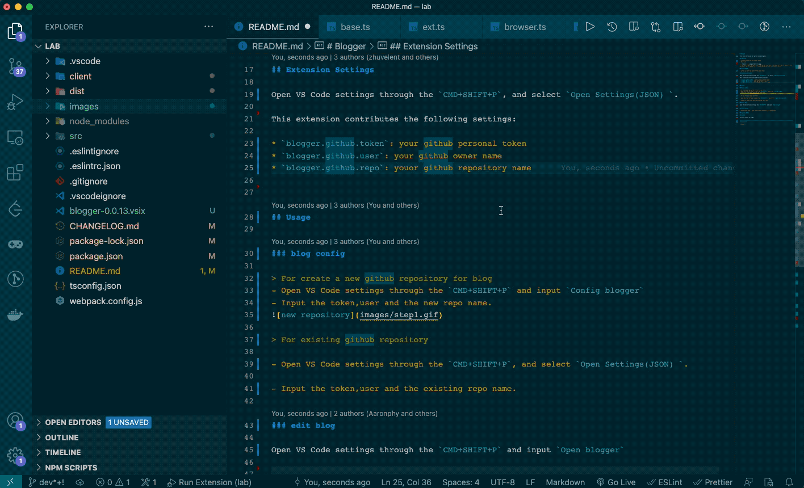
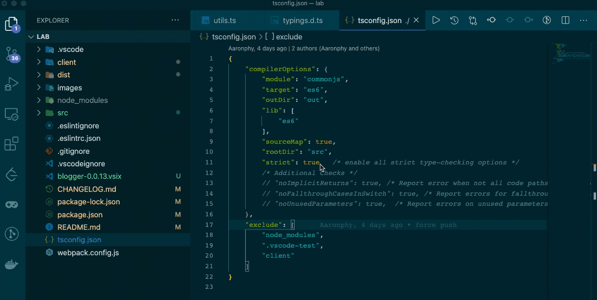

# Blogger

Esta es una extensión para blogueros que utilizan issues de GitHub.

## Características

- utiliza las APIs de GitHub para almacenar tus blogs
- fácil de usar

## Requisitos

- cuenta de GitHub (token personal, owner, repo)

## Configuración de la extensión

Abre la configuración de VS Code mediante `CMD+SHIFT+P` y selecciona `Open Settings(JSON) `.

Esta extensión aporta las siguientes configuraciones:

* `blogger.github.token`: tu token personal de GitHub
* `blogger.github.user`: tu nombre de usuario/owner de GitHub
* `blogger.github.repo`: el nombre de tu repositorio de GitHub

## Uso

### Configuración del blog

> Para crear un nuevo repositorio de GitHub para el blog
- Abre la configuración de VS Code mediante `CMD+SHIFT+P` e introduce `Config blogger`
- Introduce el token, el usuario y el nombre del nuevo repositorio.

> Para un repositorio de GitHub existente

- Abre la configuración de VS Code mediante `CMD+SHIFT+P` y selecciona `Open Settings(JSON) `.

- Introduce el token, el usuario y el nombre del repositorio existente.

### Editar blog

Abre la configuración de VS Code mediante `CMD+SHIFT+P` e introduce `Open blogger`.

## Problemas conocidos

* modo oscuro, la próxima versión tendrá soporte para modo oscuro

## Notas de la versión

### 1.0.0
### 1.0.1

Lanzamiento inicial de Blgger

-----------------------------------------------------------------------------------------------------------

**¡Disfruta!**
